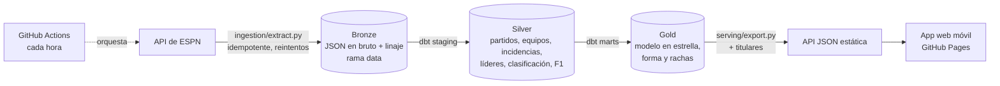
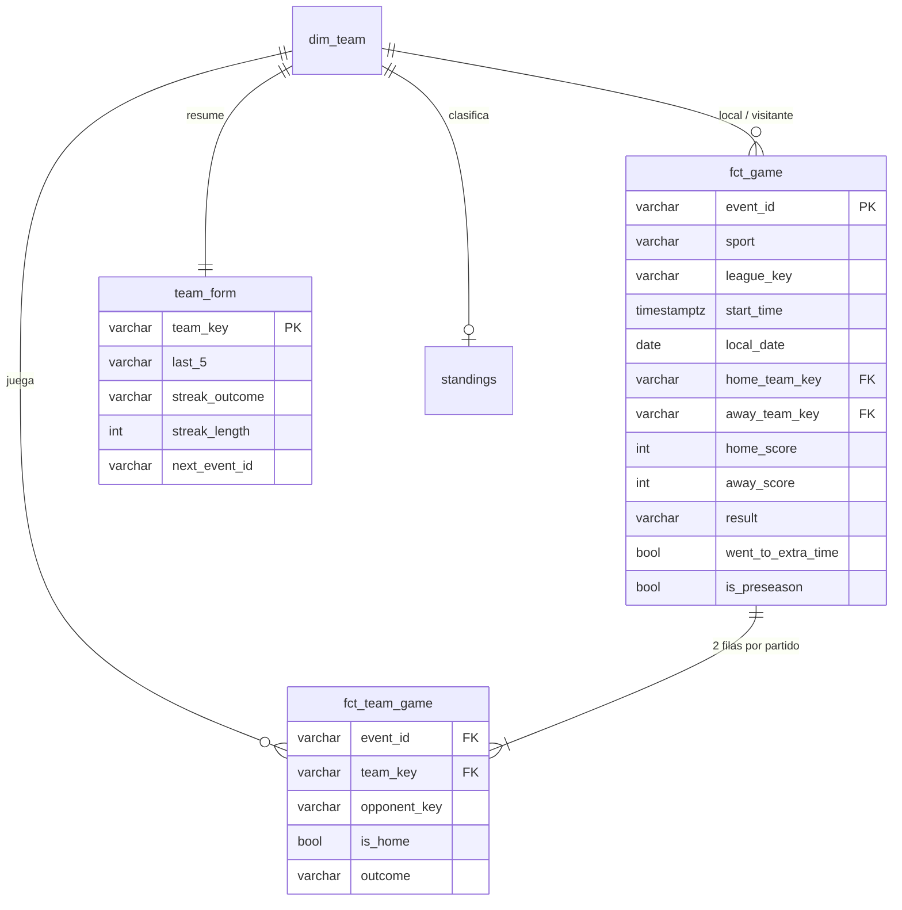

# Marcador · pipeline de datos deportivos

Plataforma de datos de principio a fin para resultados deportivos: ingesta programada desde una API
pública, lakehouse por capas (bronze → silver → gold) sobre DuckDB, transformaciones y tests de calidad
con dbt, y una capa de servicio que publica la capa gold como API estática. Encima corre una app
móvil, sin publicidad y en español, que enseña cada mañana cómo les fue a tus equipos con titulares
generados a partir de los datos.

Cubre fútbol (LaLiga, Segunda, Premier, Serie A, Bundesliga, Ligue 1, Champions, Europa League,
Conference League y Copa del Rey), NBA, NFL, MLB y Fórmula 1.

## Arquitectura



| Capa | Dónde | Qué contiene |
|---|---|---|
| Bronze | `data/bronze/espn/...json.gz` (rama `data`) | La respuesta de la API tal cual, envuelta con `source_url`, `ingested_at` y un hash SHA-256 del contenido. Particionada por entidad, liga y fecha. |
| Silver | `data/warehouse.duckdb`, esquema `silver` | JSON aplanado y tipado: un registro por partido, por equipo-partido, por incidencia (gol/tarjeta), por líder estadístico, por fila de clasificación y por piloto-sesión. Deduplicado por la ingesta más reciente. |
| Gold | esquema `gold` | Modelo dimensional listo para consumir: `dim_team`, `fct_game`, `fct_team_game`, `team_form`, `standings`, `f1_results`. |
| Servicio | `app/data/*.json` | API estática: partidos por día, ficha por equipo con titular, forma y próximo partido, equipos para el selector y F1. |

## Modelo de datos (gold)



Algunas decisiones de modelado:

- **`local_date`**: el día "natural" del aficionado. El fútbol usa la hora de Madrid y las ligas de EE. UU. la de
  Nueva York. Así, un partido de la NBA a las 2:00 en España cuenta como "anoche".
- **`fct_team_game`** desdobla cada partido en dos filas, una por equipo. Con eso, la forma, las rachas
  y los balances se calculan con funciones de ventana sencillas.
- **Rachas con *gaps-and-islands***: la racha actual es la "isla" de resultados iguales que empieza en el
  partido más reciente (`recency - row_number() over (partition by team, outcome)`).
- **Pretemporada**: se marca con `is_preseason` y no cuenta para forma ni rachas. Lo detectó un test de
  conciliación (ver abajo).

## Calidad de datos

`make transform` ejecuta 42 comprobaciones en cada carga:

- Genéricas: unicidad y no nulos en claves, valores aceptados, integridad referencial gold → `dim_team`.
- `assert_two_teams_per_game`: cada partido tiene exactamente un local y un visitante.
- `assert_linescores_sum_to_score`: en NBA, NFL y MLB la suma de parciales cuadra con el marcador.
- `assert_soccer_goals_match_score` (aviso): los goles registrados como incidencia cuadran con el resultado.
- `assert_form_reconciles_with_standings` (aviso): **conciliación entre fuentes**. Las victorias y derrotas
  calculadas desde los partidos deben coincidir con la clasificación oficial. Este test destapó que se
  contaban partidos de pretemporada.

Además, `make test` ejecuta los tests de Python (pytest): idempotencia del extractor, ventanas de temporada,
coherencia entre el catálogo de fuentes y los seeds de dbt, y cada regla del generador de titulares.

## Titulares

`serving/headlines.py` redacta en español a partir de la capa gold: *"El Barcelona remonta y gana al
Atlético"*, *"Los 76ers ganan en casa de los Bulls"*. Distingue goleada, remontada (en fútbol, quién marcó
primero; en el resto, quién iba ganando al descanso), prórroga, penaltis, final ajustado, victoria en casa o
fuera y empate. Son reglas deterministas con tests, no un modelo de lenguaje: el mismo partido produce
siempre el mismo titular.

## Ejecutarlo en local

Requisitos: [uv](https://docs.astral.sh/uv/) (instala Python 3.12 y las dependencias).

```bash
make setup      # dependencias
make backfill   # temporada completa (~1.500 peticiones, 1-2 minutos)
make pipeline   # ingesta incremental + dbt build + exportación
make app        # http://localhost:8765
```

Otros comandos: `make ingest`, `make transform`, `make serve`, `make test`.
Para explorar el warehouse: `uv run python -c "import duckdb; duckdb.connect('data/warehouse.duckdb').sql('from gold.team_form').show()"`.

## Orquestación y despliegue

`.github/workflows/pipeline.yml` corre cada hora en GitHub Actions:

1. Restaura la capa bronze desde la rama `data`.
2. `make pipeline`: ingesta incremental (últimos días y próximas 3 semanas), `dbt build` y exportación.
3. Guarda en la rama `data` solo los archivos bronze que han cambiado. El extractor compara hashes, así que
   una ejecución sin novedades no genera commit.
4. Publica `app/` en GitHub Pages.

`.github/workflows/ci.yml` ejecuta los tests y `dbt parse` en cada push y pull request.

## Decisiones y limitaciones

- **Fuente**: la API de ESPN es pública pero no oficial y puede cambiar sin aviso. Por eso bronze guarda la
  respuesta íntegra: si cambia el formato, se reprocesa el histórico sin volver a descargarlo. Este proyecto
  es de aprendizaje y no redistribuye datos con fines comerciales.
- **Frescura**: con una ejecución por hora, los partidos "en directo" pueden ir hasta una hora por detrás. El
  caso de uso principal (ver los resultados por la mañana) no lo necesita. El tiempo real está en la hoja de
  ruta.
- **Bronze en git**: es suficiente para una temporada (unos 10 MB comprimidos) y no cuesta nada. A más escala
  iría a almacenamiento de objetos.
- **Dimensiones SCD tipo 1**: guardan solo los atributos más recientes de cada equipo. El historial de cambios
  (SCD tipo 2) está en la hoja de ruta.

## Hoja de ruta

- **Fase 2**: orquestador (Dagster), almacenamiento de objetos (S3 o MinIO) para bronze, Postgres o un
  warehouse en la nube, API con FastAPI, backfill de temporadas anteriores, fuentes oficiales adicionales
  (MLB StatsAPI, Jolpica para F1) con resolución de entidades entre fuentes, y SCD tipo 2 en `dim_team`.
- **Fase 3**: partidos en directo en streaming (Redpanda/Kafka → WebSockets), ratings Elo y probabilidad de
  victoria, dashboard analítico, infraestructura como código y monitorización de frescura.

## Estructura

```
ingestion/   extractor y catálogo de fuentes
transform/   proyecto dbt: staging (silver), marts (gold), seeds, tests, macros
serving/     exportación a JSON y generador de titulares
app/         app web (HTML + JS sin dependencias)
tests/       tests de Python
.github/     pipeline programado y CI
```
